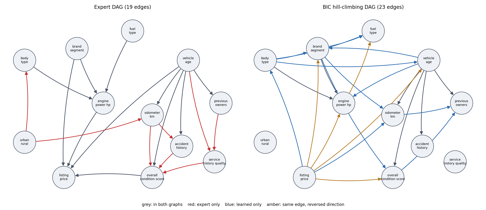

# CSE250a-BayesCar

CSE 250A final project. We model vehicle listing price tiers with a discrete Bayesian network on the Kaggle [Cars Dataset (2026)](https://www.kaggle.com/datasets/datascikhan/cars-dataset), which is 100,000 synthetic records. Results describe this synthetic dataset only, not real-market or causal relationships.

## Layout

| Path | Contents |
| --- | --- |
| `dataset/data_cleaning_analysis.ipynb` | Variable selection, 80/10/10 split (seed 42), binning, MCAR mask helper |
| `dataset/prepared/` | `train.csv`, `val.csv`, `test.csv`, `schema.json` (state order and cut points), `column_audit.csv` |
| `structure/config.json` | Expert DAG edge list and E1 settings |
| `structure/bn.py` | BIC score, hill climbing, Chow-Liu, smoothed CPTs, log-likelihood, CI tests |
| `structure/run_e1.py` | Runs E1 and writes everything in `structure/outputs/` |

## Data

12 discrete variables. Bins and category codes are fit on training rows only. Load a split with `pd.read_csv(path, index_col="source_row", dtype="Int64")`. Blanks are real missing values in `service_history_quality` (about 4%) and `overall_condition_score` (about 1%).

## E1: structure learning

```bash
pip install numpy pandas scipy networkx matplotlib
```

```bash
python structure/run_e1.py
```

Every structure uses the same variables, bins, complete-case rows (train 76,081 of 80,000, test 9,474 of 10,000), at most 4 parents per node, and CPTs with add-one smoothing fit on train. Hill climbing uses add, delete and reverse moves on the BIC score, started from the empty graph, the expert DAG and 10 random DAGs. The run with the best training BIC is kept.

| Structure | Edges | Params | Train BIC | Val LL / row | Test LL / row | Test gain vs expert |
| --- | --- | --- | --- | --- | --- | --- |
| BIC hill climbing | 23 | 851 | -824,577 | -10.782 | -10.781 | +0.138 ± 0.005 |
| Expert DAG | 19 | 611 | -833,447 | -10.922 | -10.919 | 0 |
| Chow-Liu tree | 11 | 98 | -854,243 | -11.216 | -11.221 | -0.302 ± 0.008 |
| Naive Bayes | 11 | 129 | -891,708 | -11.700 | -11.694 | -0.775 ± 0.017 |
| Empty graph | 0 | 29 | -1,004,869 | -13.192 | -13.190 | -2.271 ± 0.017 |

Log-likelihoods are joint, in nats per record. The gain column is the paired per-record difference on the same test rows, with its standard error.



Notes for the report:

- The learned DAG beats the expert DAG by 0.14 nats per record on test. The expert DAG still closes most of the gap between the empty graph and the learned one with 240 fewer parameters.
- The two graphs share 11 skeleton edges, 6 with the same direction and 5 reversed. Reversals are not evidence about causality, since BIC cannot distinguish graphs in the same Markov equivalence class. With the 4-parent cap, the search makes `listing_price` a parent of several attributes instead of their child.
- `service_history_quality` and `urban_rural` are isolated in the learned graph. Their mutual information with every other variable is below 0.0001 nats, so 5 of the 8 expert-only edges encode dependencies that this dataset does not contain.
- The expert DAG's biggest misses are price given body type, fuel type and mileage (CMI 0.03 to 0.05 nats given the price parents) and brand given body type. See `outputs/ci_tests_expert.csv`. With 76k rows the G-test rejects tiny effects, so read the CMI column, not only the p-value.
- Greedy search is sensitive to its start. The 12 runs end at training BIC between -829,010 and -824,577, and the empty and expert starts reach the same local optimum (`outputs/hc_restarts.csv`).

Other parts should read both graphs from `structure/outputs/dags.json` (`edges.expert` and `edges.hill_climb_bic`) so that inference and price prediction use exactly these structures. The test split was used only for the final table above.
