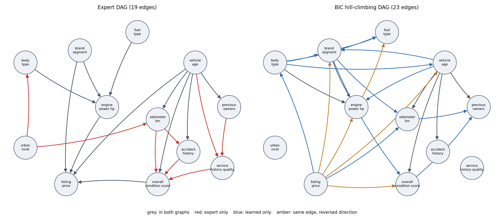

# CSE250a-BayesCar

CSE 250A final project. We model vehicle listing price tiers with a discrete Bayesian network on the Kaggle [Cars Dataset (2026)](https://www.kaggle.com/datasets/datascikhan/cars-dataset), which has 100,000 synthetic records. Because the data is synthetic, the results say nothing about real car prices or causal effects.

Who does what is in [WORK_SPLIT.md](WORK_SPLIT.md).

| Experiment | Question | Part | Code | Report |
| --- | --- | --- | --- | --- |
| [E1](#e1--structure-learning) | Does a learned DAG fit better than the expert DAG? | B | [structure/](structure/) | This README |
| [E2](#e2--missing-data) | How do deletion, imputation and EM compare under missing data? | A | [complete-case_MLE_and_EM/](complete-case_MLE_and_EM/) | [MLE_EM.ipynb](complete-case_MLE_and_EM/MLE_EM.ipynb) |
| [E3](#e3--latent-variable) | Does a latent factor H recover vehicle condition? | C | [parameter_learning/](parameter_learning/) | [REPORT.md](parameter_learning/REPORT.md) |
| [E4](#e4--exact-and-approximate-inference) | How do sampling methods compare with exact VE? | D | [inference/](inference/) | [REPORT.md](inference/REPORT.md) |
| [E5](#e5--price-tier-prediction) | How well do the networks predict the price tier? | E | [prediction/](prediction/) | [REPORT.md](prediction/REPORT.md) |

## Reproduce

Use Python 3.11 and run everything from the repository root. `prediction/requirements.txt` pulls in the Part C and Part D requirements, so one install is enough.

```bash
python3.11 -m venv .venv
source .venv/bin/activate
python -m pip install -r prediction/requirements.txt
python -m pytest -q parameter_learning/tests inference/tests prediction/tests
```

Run the experiments in this order, since each step reads what the earlier ones wrote.

```bash
python structure/run_e1.py                # E1, writes structure/outputs/
python -m parameter_learning.run_part_c   # CPTs, EM and E3, writes parameter_learning/outputs/
python -m inference.check_setup           # checks VE against pgmpy on both graphs
python -m inference.run_e4                # E4, writes inference/outputs/
python -m prediction.run_e5               # E5, writes prediction/outputs/
```

E2 lives in the notebook [MLE_EM.ipynb](complete-case_MLE_and_EM/MLE_EM.ipynb). Point `root` in its second cell at your checkout before running it.

## Repository layout

| Path | Part | Contents |
| --- | --- | --- |
| [dataset/](dataset/) | A | Cleaning notebook, prepared `train.csv`, `val.csv`, `test.csv`, `schema.json` and `column_audit.csv` |
| [complete-case_MLE_and_EM/](complete-case_MLE_and_EM/) | A | E2 notebook comparing complete-case MLE, mode imputation and EM under MCAR masks |
| [structure/](structure/) | B | BIC score, hill climbing, Chow-Liu, CI tests and the shared `outputs/dags.json` |
| [parameter_learning/](parameter_learning/) | C | Smoothed MLE, exact missing-data EM, fitted models and E3 |
| [inference/](inference/) | D | `query_ve`, likelihood weighting, Gibbs and rejection sampling, E4 |
| [prediction/](prediction/) | E | Price-tier prediction, baselines, metrics and E5 |

## Data

The data has 12 discrete variables and an 80/10/10 split (seed 42). Bins and category codes come from the training rows only. Load a split with `pd.read_csv(path, index_col="source_row", dtype="Int64")` and take state order from `dataset/prepared/schema.json`. Blanks are real missing values in `service_history_quality` (about 4%) and `overall_condition_score` (about 1%). We dropped `days_on_market` and `demand_category` because nobody knows them until after the car is listed.

## E1 · Structure learning

```bash
python structure/run_e1.py
```

Every structure uses the same variables, bins, complete-case rows (train 76,081 of 80,000, test 9,474 of 10,000), at most 4 parents per node, and CPTs with add-one smoothing fit on train. Hill climbing uses add, delete and reverse moves on the BIC score, started from the empty graph, the expert DAG and 10 random DAGs. The run with the best training BIC is kept.

| Structure | Edges | Params | Train BIC | Val LL / row | Test LL / row | Test gain vs expert |
| --- | --- | --- | --- | --- | --- | --- |
| BIC hill climbing | 23 | 851 | -824,577 | -10.782 | -10.781 | +0.138 ± 0.005 |
| Expert DAG | 19 | 611 | -833,447 | -10.922 | -10.919 | 0 |
| Chow-Liu tree | 11 | 98 | -854,243 | -11.216 | -11.221 | -0.302 ± 0.008 |
| Naive Bayes | 11 | 129 | -891,708 | -11.700 | -11.694 | -0.775 ± 0.017 |
| Empty graph | 0 | 29 | -1,004,869 | -13.192 | -13.190 | -2.271 ± 0.017 |

Log-likelihoods are joint, in nats per record. The gain column is the paired per-record difference on the same test rows, with its standard error.



- The learned DAG beats the expert DAG by 0.14 nats per record on test. The expert DAG still closes most of the gap between the empty graph and the learned one with 240 fewer parameters.
- The two graphs share 11 skeleton edges, 6 with the same direction and 5 reversed. Reversals are not evidence about causality, since BIC cannot distinguish graphs in the same Markov equivalence class. With the 4-parent cap, the search makes `listing_price` a parent of several attributes instead of their child.
- `service_history_quality` and `urban_rural` are isolated in the learned graph. Their mutual information with every other variable is below 0.0001 nats, so 5 of the 8 expert-only edges encode dependencies that this dataset does not contain.
- The expert DAG's biggest misses are price given body type, fuel type and mileage (CMI 0.03 to 0.05 nats given the price parents) and brand given body type. See `structure/outputs/ci_tests_expert.csv`. With 76k rows the G-test rejects tiny effects, so read the CMI column, not only the p-value.
- Greedy search is sensitive to its start. The 12 runs end at training BIC between -829,010 and -824,577, and the empty and expert starts reach the same local optimum (`structure/outputs/hc_restarts.csv`).

All later parts read both graphs from `structure/outputs/dags.json` (`edges.expert` and `edges.hill_climb_bic`). The test split was only used for the final table above.

## E2 · Missing data

Part A's [notebook](complete-case_MLE_and_EM/MLE_EM.ipynb) hides an extra 0%, 20% or 40% of the observed `service_history_quality` and `overall_condition_score` cells in the training split, completely at random. It fits the expert DAG on each masked copy with complete-case MLE, with mode imputation followed by MLE, and with Part C's EM. The three methods see the same mask, and each rate is repeated with three masking seeds.

| Added masking | Complete-case MLE | Mode imputation + MLE | EM | Complete-case training rows kept |
| --- | ---: | ---: | ---: | ---: |
| 0% | -10.86407 | -10.86682 | -10.86374 | 76,081 / 80,000 (95.1%) |
| 20% | -10.86595 | -10.99005 | -10.86431 | 48,699 / 80,000 (60.9%) |
| 40% | -10.87056 | -11.22263 | -10.86666 | 27,441 / 80,000 (34.3%) |

Values are test log-likelihood in nats per row, averaged over the three seeds. EM comes out on top at every rate and beats complete-case MLE on both test log-likelihood and CPT KL in all six masked runs, though complete-case MLE stays close even when it keeps only a third of the rows. Mode imputation gets much worse as more cells are hidden. The notebook also has condition-score recovery accuracy and per-seed results.

## E3 · Latent variable

```bash
python -m parameter_learning.run_part_c
```

Part C ([guide](parameter_learning/README.md), [report](parameter_learning/REPORT.md)) fits smoothed MLE and exact missing-data EM for both graphs. It then adds a three-state latent root H as a shared parent of accident history, service history, condition score and price. `condition_grade` never enters training and is only used afterwards to measure how well H lines up with it. All nine EM fits converge. The latent graph scores slightly worse on held-out data than the expert EM fit (-0.020 ± 0.002 nats per row). H also has little to do with condition grade, with a test NMI of 0.115 for the selected seed compared with 0.719 for the observed condition score.

## E4 · Exact and approximate inference

```bash
python -m inference.run_e4
```

Part D ([guide](inference/README.md), [report](inference/REPORT.md)) implements variable elimination as `inference.query_ve`. It matches pgmpy to within `1e-10` on both graphs and returns the exact price posterior in about 0.1 ms. On the expert network it is compared with likelihood weighting, Gibbs and rejection sampling. At 10,000 draws likelihood weighting has the smallest error, with mean TV 0.006 under common evidence and 0.010 under rare evidence. Rejection sampling falls apart under rare evidence (TV 0.15).

## E5 · Price-tier prediction

```bash
python -m prediction.run_e5
```

Part E ([guide](prediction/README.md), [report](prediction/REPORT.md)) predicts the price tier of every test row with exact VE. It uses the expert DAG, the learned DAG, Chow-Liu, naive Bayes and the prior, plus a logistic regression baseline, and runs each one with all features and again without the condition and history fields. With all features the learned DAG gets 67.1% right and the expert DAG 63.9%, where chance is 20%. Logistic regression lands at 67.9%, about the same as the learned DAG. The expert DAG has the best calibrated probabilities.
