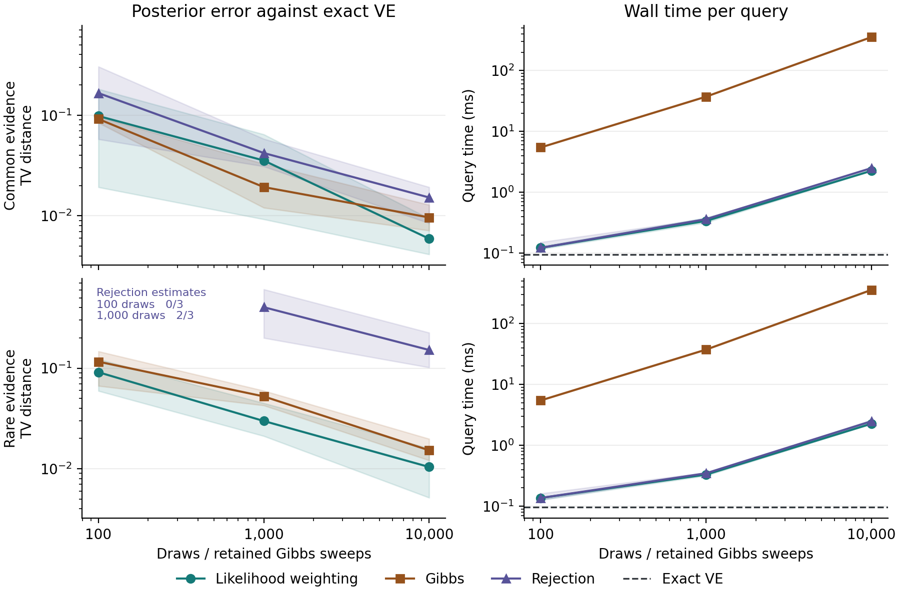

# E4 · Inferring vehicle price tiers under common and rare evidence

On the selected 12-node expert network, variable elimination (VE) returned the exact five-tier price posterior in about 0.10 ms per query. Likelihood weighting gave the smallest mean error of the three samplers at 10,000 draws for both evidence cases. Rejection sampling was especially sensitive to the evidence combination.

## Modeling and inference · §3

The query was **P(listing price tier | odometer tier, overall condition tier)**. All other attributes were marginalized. All four methods used the same discrete CPTs from Part C's validation-selected expert EM fit. VE indexed each CPT in saved parent order, restricted its axes to the observed states, multiplied factors sharing a hidden variable, and summed out that variable. At each step it eliminated the variable whose factors had the smallest product of state counts across their combined scope. Normalizing the remaining target masses gave the posterior. Against pgmpy and Part C's enumeration, all four common/rare queries across the expert and hill-climb graphs agreed to absolute tolerance `1e-10`. [Implementation](exact.py) · [Reference checks](check_setup.py) · [pgmpy](https://pypi.org/project/pgmpy/1.1.2/)

Likelihood weighting sampled in topological order, clamped the two evidence nodes, and weighted each draw by the product of their conditional probabilities. Rejection sampling drew complete records from the fitted network and retained exact evidence matches. Gibbs initialized with a clamped forward draw, held evidence fixed, and updated each free node once per sweep, in topological order. Its update probabilities were proportional to the node's CPT times the CPTs of its children at their current states. It recorded one price tier after each retained sweep. [Samplers](sampling.py)

## Experimental design

Of 10,000 validation rows, 9,891 had both evidence fields observed. We fixed the most and least frequent observed pairs using this split. Both had condition score ≤ 70.5. The common case had odometer above 93,617⅓ km, and the rare case had odometer at or below 34,571 km. The E4 reference distribution for each fixed query came from the fitted model. This allowed direct error measurement without test-row labels. [Validation schema](../dataset/prepared/schema.json) · [Exact results](outputs/exact.csv)

| Evidence | Validation count | Fitted P(evidence) | Exact price posterior, tiers 0 through 4 |
| --- | ---: | ---: | --- |
| Common | 2,607 / 9,891 | 0.257535 | 0.59484, 0.26880, 0.07924, 0.03790, 0.01922 |
| Rare | 33 / 9,891 | 0.003234 | 0.17818, 0.30615, 0.26870, 0.12468, 0.12229 |

Sampling budgets were 100, 1,000 and 10,000 proposals for weighting and rejection, or retained sweeps for Gibbs. Seeds 0, 1 and 2 gave 54 runs. Separate pilot chains used seeds 101–103 and 2,000-draw windows after discarding 50, 200 or 500 sweeps. The selection rule took the smallest burn-in for which all six case/seed windows achieved TV ≤ 0.08. It selected 50 sweeps with worst pilot TV 0.0456. This checks price-posterior accuracy for these cases and gives limited information about mixing elsewhere in the graph. [Pilot results](outputs/gibbs_pilot.csv)

For estimate `p` and exact posterior `q`, total variation (TV) is `0.5 × sum(abs(p − q))` across the five tiers. For each seed, wall time was the median of three full query calls including sampler setup and Gibbs burn-in. Each repeat reset the seed. The exact baseline was the median of 31 calls after a correctness check. Model loading was timed separately, and the sampling configurations ran in a fixed shuffled order on an arm64 Mac with Python 3.11.10. [Benchmark](run_e4.py) · [Run settings](outputs/settings.json)

## Results and discussion · §4

| Method at 10,000 draws or retained sweeps | Common TV, mean ± SD | Common time (ms) | Rare TV, mean ± SD | Rare time (ms) |
| --- | ---: | ---: | ---: | ---: |
| Exact VE | 0 | 0.096 | 0 | 0.097 |
| Likelihood weighting | 0.0059 ± 0.0030 | 2.26 | 0.0104 ± 0.0054 | 2.26 |
| Gibbs | 0.0096 ± 0.0029 | 353 | 0.0153 ± 0.0041 | 356 |
| Rejection | 0.0152 ± 0.0059 | 2.50 | 0.1515 ± 0.0650 | 2.48 |

*Points show mean TV or median runtime across seeds. Shading spans the observed seed range. TV summaries include only runs that produced a posterior. For rare evidence, rejection yielded estimates for 0/3 seeds at 100 draws, 2/3 at 1,000, and 3/3 at 10,000. The dashed runtime line is exact VE.* [Full summary](outputs/summary.csv)

The model assigned the lowest price tier probability 0.595 for high-mileage, low-condition cars and 0.178 for low-mileage cars in the same condition tier. Only 33 validation rows supported the second evidence combination. The exact calculation characterizes the fitted model, while the empirical accuracy of that price distribution is a separate prediction question.

For rare evidence, 10,000 prior proposals would yield about 32 matches in expectation. Rejection accepted 36 on average, compared with 2,559 under common evidence. Weighting used every proposal and had mean effective sample sizes of 8,364 and 4,033 for rare and common evidence respectively, using `(sum w)^2 / sum(w^2)`. Small evidence probability reduces rejection acceptance directly. Weighting efficiency depends on the relative spread of the weights, and the rare case here had the larger effective sample size.

Gibbs produced an estimate for every run. The lag-one correlation of the lowest-tier indicator averaged 0.45 for common and 0.49 for rare evidence at 10,000 sweeps. Successive sweeps therefore shared information. The timing gap also reflects the use of vectorized forward sampling across proposals and sequential Gibbs updates in Python. [Per-seed estimates and diagnostics](outputs/runs.csv)

VE was the fastest measured method for both queries and supplies the exact prediction interface for Part E. Its cost depends on the sizes of intermediate factors, so timings on these two queries in a small graph do not establish how the methods rank on larger or denser networks. Three seeds give a descriptive range, and both cases come from one synthetic dataset and one fitted expert model.

## Integration and contribution notes · §6

Part D supplies the exact query, the cross-library checks on both selected models, and the three-seed E4 comparison. Codex assisted with implementation, debugging, running the benchmark, producing the figure and drafting these notes. For the team submission, the contributor should adapt the text and record their own review, contributions and personal learning.
