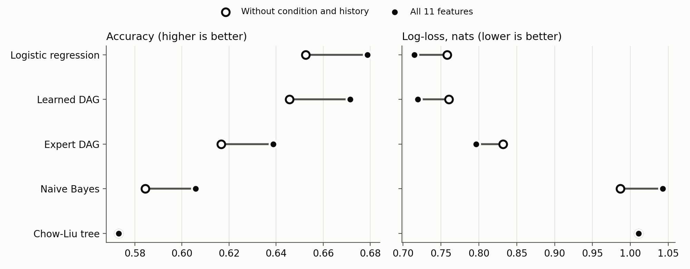
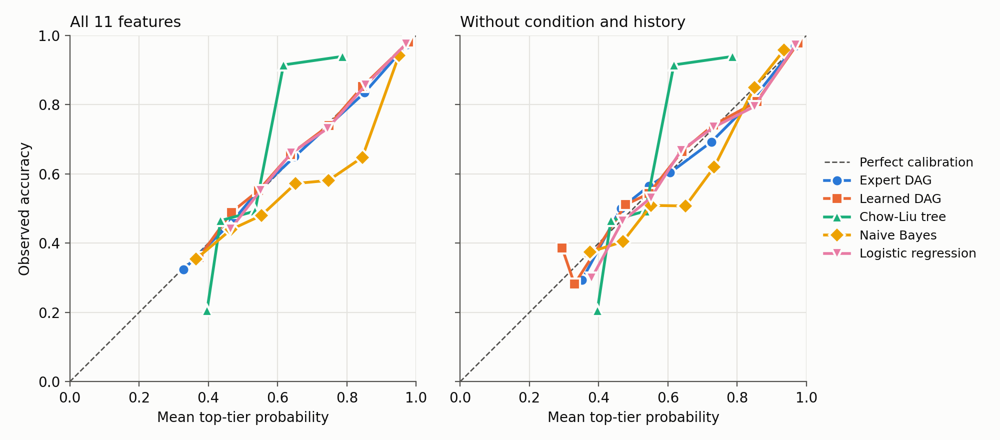

# E5 · Predicting the listing price tier

With exact VE on all 10,000 test rows, the learned DAG predicted the price tier with 67.1% accuracy and a log-loss of 0.720 nats. The expert DAG reached 63.9% and 0.796. A multinomial logistic regression on the same features scored 67.9% and 0.715, close to the learned DAG. The expert DAG was the best calibrated of the three and the least accurate.

## Setup

The target is `listing_price`, cut into five equal-frequency tiers on the training split, so guessing a single tier is right 20% of the time. Every model scored the same test rows with the same evidence. For the networks, P(price tier | observed features) came from Part D's `query_ve`. A missing feature was left out of the evidence and summed out, so the 526 test rows with a missing value were scored like any other row. [Scoring code](core.py) · [Run script](run_e5.py)

We used two evidence sets. The first has all 11 non-price variables. The second drops `accident_history`, `service_history_quality` and `overall_condition_score`, which is roughly what a buyer knows from the listing before an inspection or a vehicle history report. Part A had already removed `days_on_market` and `demand_category`, which are only known after listing.

| Model | Structure | Parameters |
| --- | --- | --- |
| Expert DAG | `edges.expert` | Part C EM fits for seeds 0, 1 and 2, seed 2 selected |
| Learned DAG | `edges.hill_climb_bic` | Part C EM fits for seeds 0, 1 and 2, seed 2 selected |
| Chow-Liu tree | `edges.chow_liu` | EM with Part C settings and seeds, selected by validation log-likelihood |
| Naive Bayes | `edges.naive_bayes` | Same as Chow-Liu |
| Prior only | `edges.empty` | Same as Chow-Liu |
| Logistic regression | One-hot features plus a missing-value indicator | `C` = 100, chosen by validation log-loss |

Validation data chose the EM seeds and `C`, and test data was used only for the numbers below. Validation log-loss for logistic regression changed by less than 0.0002 between `C` = 1 and 100, so the selected fit is close to unregularized. [Settings](outputs/settings.json)

We report the accuracy of the most probable tier, the log-loss (mean negative log probability of the true tier), the mean absolute tier error and the top-label expected calibration error (ECE) over ten equal-width confidence bins. The tier error counts how many tiers a prediction is off by, which matters because the tiers are ordered. The three EM seeds gave identical accuracy and log-loss within 1e-7 nats for every network, since only two variables have missing values (about 4% and 1% of rows) and EM reaches the same optimum from each start. The ± values below are paired standard errors over the same test rows.

## Results

### All 11 features

| Model | Accuracy | Log-loss | Tier MAE | ECE | Accuracy gain vs expert | Log-loss gain vs expert |
| --- | ---: | ---: | ---: | ---: | ---: | ---: |
| Logistic regression | 0.679 | 0.715 | 0.341 | 0.011 | +0.040 ± 0.004 | +0.082 ± 0.004 |
| Learned DAG | 0.671 | 0.720 | 0.351 | 0.012 | +0.033 ± 0.004 | +0.077 ± 0.004 |
| Expert DAG | 0.639 | 0.796 | 0.393 | 0.005 | 0 | 0 |
| Naive Bayes | 0.606 | 1.043 | 0.485 | 0.101 | −0.033 ± 0.005 | −0.246 ± 0.010 |
| Chow-Liu tree | 0.573 | 1.011 | 0.500 | 0.070 | −0.066 ± 0.005 | −0.215 ± 0.005 |
| Prior only | 0.206 | 1.609 | 1.469 | 0.006 | −0.433 ± 0.006 | −0.813 ± 0.007 |

### Without condition and history

| Model | Accuracy | Log-loss | Tier MAE | ECE | Accuracy gain vs expert | Log-loss gain vs expert |
| --- | ---: | ---: | ---: | ---: | ---: | ---: |
| Logistic regression | 0.653 | 0.758 | 0.372 | 0.017 | +0.036 ± 0.004 | +0.074 ± 0.004 |
| Learned DAG | 0.646 | 0.760 | 0.384 | 0.017 | +0.029 ± 0.004 | +0.072 ± 0.003 |
| Expert DAG | 0.617 | 0.832 | 0.422 | 0.023 | 0 | 0 |
| Naive Bayes | 0.584 | 0.987 | 0.501 | 0.077 | −0.032 ± 0.004 | −0.154 ± 0.008 |
| Chow-Liu tree | 0.573 | 1.011 | 0.500 | 0.070 | −0.044 ± 0.003 | −0.179 ± 0.004 |
| Prior only | 0.215 | 1.609 | 1.465 | 0.015 | −0.401 ± 0.006 | −0.777 ± 0.007 |

Gains are positive when a model beats the expert DAG. Log-loss gain is the expert's per-row loss minus the model's. The training tiers are exactly balanced, so the prior-only model's top tier is a numerical tie and its accuracy moves between 0.20 and 0.22 across seeds. [Summary](outputs/summary.csv) · [Paired gains](outputs/paired.csv)

*Filled points use all 11 features and hollow points drop the condition and history fields. The prior-only model is off the axis (accuracy 0.21, log-loss 1.61).*

*Top-label reliability, with bins under 30 test rows hidden. Points below the diagonal mean the model was overconfident.* [Calibration bins](outputs/calibration.csv)

## Discussion

The learned DAG beats the expert DAG by 3.3 accuracy points and 0.077 nats of log-loss, and the accuracy gain is about nine standard errors. E1 found the same ordering in joint log-likelihood, where the learned graph led by 0.14 nats per record. With all other variables observed, price depends only on its Markov blanket. In the expert graph that blanket is the four parents of price (brand segment, engine power, condition score and vehicle age). The learned graph makes price a parent of six attributes, which adds body type and odometer to the blanket. E1's conditional independence tests found that price depends on body type, fuel type and mileage given the expert parents, and the expert graph has no way to use those dependencies.

Logistic regression was 0.7 ± 0.4 points more accurate than the learned DAG, about two standard errors, and their log-loss differed by 0.005 ± 0.003 nats. The learned network was fit to the joint distribution and never trained to predict price, yet it came within a point of a discriminative model on these discretized features. Logistic regression also needs a new fit for each evidence set, while the network answers both sets from the same CPTs.

The expert DAG had the lowest calibration error (ECE 0.005), so its probabilities match observed frequencies even though its top choice is wrong more often. Naive Bayes was the most overconfident (ECE 0.10), and its log-loss improved from 1.043 to 0.987 when the condition and history fields were removed. It treats age, mileage and condition as independent given price, so it counts correlated evidence several times over.

In the Chow-Liu tree, price connects only to brand segment, vehicle age and urban/rural. Once those three are observed the other features cannot change the prediction, so both evidence sets give the same results and the lowest accuracy apart from the prior (57.3%). The learned DAG isolates `service_history_quality` and `urban_rural`, so they have no effect on its predictions either.

Dropping the condition and history fields cost 2.2 accuracy points for the expert DAG and 2.6 for both the learned DAG and logistic regression. The ranking of the models did not change.

## Contributions

Part E provides the prediction protocol, the baselines, the metrics and this analysis. Claude Code helped write the code and tests, run the experiment, make the figures and draft this report.
