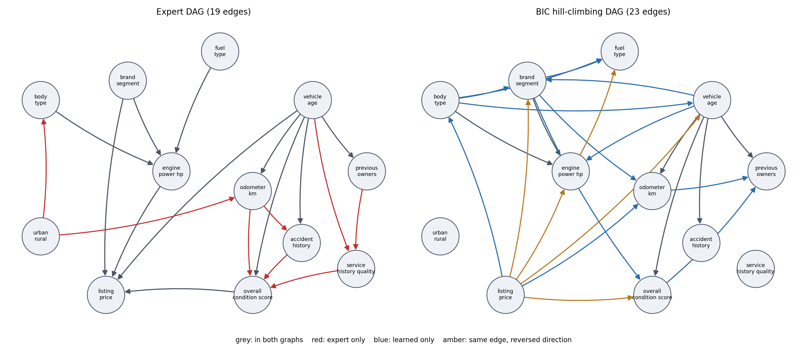

# Part B · Structure learning and E1

Part B defines the expert DAG, learns a second DAG with BIC hill climbing, and compares both with simple baselines on held-out joint log-likelihood. The expert edge list and settings are in [config.json](config.json), the algorithms are in [bn.py](bn.py), and [run_e1.py](run_e1.py) writes everything in [outputs/](outputs/).

## Reproduce

Run from the repository root. It takes a few seconds.

```bash
python -m structure.run_e1
```

## Setup

Every structure uses the same variables, bins, complete-case rows (train 76,081 of 80,000, test 9,474 of 10,000), at most 4 parents per node, and CPTs with add-one smoothing fit on train. Hill climbing uses add, delete and reverse moves on the BIC score, started from the empty graph, the expert DAG and 10 random DAGs. The run with the best training BIC is kept.

## Results

| Structure | Edges | Params | Train BIC | Val LL / row | Test LL / row | Test gain vs expert |
| --- | --- | --- | --- | --- | --- | --- |
| BIC hill climbing | 23 | 851 | -824,577 | -10.782 | -10.781 | +0.138 ± 0.005 |
| Expert DAG | 19 | 611 | -833,447 | -10.922 | -10.919 | 0 |
| Chow-Liu tree | 11 | 98 | -854,243 | -11.216 | -11.221 | -0.302 ± 0.008 |
| Naive Bayes | 11 | 129 | -891,708 | -11.700 | -11.694 | -0.775 ± 0.017 |
| Empty graph | 0 | 29 | -1,004,869 | -13.192 | -13.190 | -2.271 ± 0.017 |

Log-likelihoods are joint, in nats per record. The gain column is the paired per-record difference on the same test rows, with its standard error.



## Findings

- The learned DAG beats the expert DAG by 0.14 nats per record on test. The expert DAG still closes most of the gap between the empty graph and the learned one with 240 fewer parameters.
- The two graphs share 11 skeleton edges, 6 with the same direction and 5 reversed. Reversals are not evidence about causality, since BIC cannot distinguish graphs in the same Markov equivalence class. With the 4-parent cap, the search makes `listing_price` a parent of several attributes instead of their child.
- `service_history_quality` and `urban_rural` are isolated in the learned graph. Their mutual information with every other variable is below 0.0001 nats, so 5 of the 8 expert-only edges encode dependencies that this dataset does not contain.
- The expert DAG's biggest misses are price given body type, fuel type and mileage (CMI 0.03 to 0.05 nats given the price parents) and brand given body type. See [ci_tests_expert.csv](outputs/ci_tests_expert.csv). With 76k rows the G-test rejects tiny effects, so read the CMI column, not only the p-value.
- Greedy search is sensitive to its start. The 12 runs end at training BIC between -829,010 and -824,577, and the empty and expert starts reach the same local optimum ([hc_restarts.csv](outputs/hc_restarts.csv)).

## Handoff

All later parts read both graphs from [outputs/dags.json](outputs/dags.json) (`edges.expert` and `edges.hill_climb_bic`). The test split was only used for the final table above.
